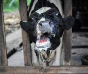

# MKZ Bij Evenhoevige Dieren

Captured: 2026-10-31T22:34:04.793Z

Source: https://www.google.com/search?sca_esv=e9991be60d889d2d&sxsrf=AKL5yDh26C-Ra7LeZ38NpbtY_NP3B32g7w%3A1793483899704&vsint=&ntc=1&cs=1&sa=X&ved=0CAcQ2_wOahcKEwiI_brfp-WXAxUAAAAAHQAAAAAQVQ&biw=1707&bih=898&dpr=1.5&udm=50&arv=3&atvm=2&mstk=AUtExfA1xHmX3IDPaQSb2r0QvBLkIYLAMCs1hWmOEpihNzPqkH1WKoLeyLeNtsMdrrPATwpyQenGdHvDt-YAUXI4lz7yUikYbfI-L8sHhoWBPnMRQ3JkmDYW45QO-4ohKNR9OZ2nRLgrwdPRSNU1O4Ov_LDIXBw7NWhLT0GKtCoHqI_nnDAecvjejXB21_t36WJtvV0zyU4e3sGxovi1QZeJ2XK_GJueCcvYOL9XcLCcQkDFVNZyiiZjjsCyNp9SzQklDlHZni0CtnaXQiN0Cc_acZ2YZZKcss4fXbpeHu0763rgAdA6W9VGvwGg3D0MCMQtG3sD4qZXHi52x2CjDMabBpoyiqR1cTquhQ&mtid=ZVHmarT4GsOWi-gP8uGlyA0&csuir=1&aep=26&q=MKZ+dieren

## Prompt 1 — You

MKZ dieren

## Response 1 — Google AI Mode

Mond-en-klauwzeer (MKZ) is een zeer besmettelijke virusziekte die voorkomt bij **evenhoevige dieren** (zoals runderen,

varkens

,

schapen

,

geiten

, herten en

wilde zwijnen

). 

Wikipedia +1

### Welke dieren zijn vatbaar?

* **Wel vatbaar:** Runderen,

  varkens

  ,

  schapen

  ,

  geiten

  , lama's, alpaca's, herten, reeën en

  wilde zwijnen

  .
* **Niet vatbaar:** Paarden,

  honden

  , katten en

  pluimvee

  .
* **Mensen:** Mensen kunnen zelf niet ziek worden van MKZ (het is ongevaarlijk voor de volksgezondheid), maar kunnen het virus wel onbedoeld via kleding, schoenen of materialen verspreiden. 

  Rijksoverheid.nl +4

### Belangrijkste symptomen

* **Blaasjes en zweren:** Pijnlijke blaren en aften in de bek (op de tong, het tandvlees en de lippen) en op de poten rond de kroonrand en tussen de hoeven/klauwen. 

  NVWA +2
* **Gedrag en fysiek:** Hoge koorts, veel kwijlen of schuimbekken, minder eten en een plotseling dalende melkproductie bij runderen. 

  Boerderij +2
* **Verschillen per dier:** Bij runderen en

  varkens

   zijn de klachten vaak hevig en pijnlijk (leidend tot kreupelheid), terwijl

  schapen

   en

  geiten

  de ziekte vaak milder doormaken. Bij jonge dieren kan het virus een hartspierontsteking veroorzaken met een dodelijke afloop. 

  Dutch Wildlife Health Centre | DWHC +3

### Meldplicht

In Nederland en België geldt een strenge **meldplicht**: veehouders en dierenartsen zijn wettelijk verplicht een vermoeden van MKZ direct te melden bij de [Nederlandse Voedsel- en Warenautoriteit (NVWA)](https://www.nvwa.nl/onderwerpen/dier/mkz) of de bevoegde instanties. 

DGZ +2

Wil je meer weten over de **maatregelen bij een uitbraak** of de **geschiedenis van de MKZ-crisis**?

### Source links

- [nl.wikipedia.org](https://nl.wikipedia.org/wiki/Mond-en-klauwzeer)
- [www.rijksoverheid.nl](https://www.rijksoverheid.nl/themas/klimaat-milieu-en-natuur/diergezondheid/maatregelen-mond-en-klauwzeer-virus-mkz)
- [Nederlandse Voedsel- en Warenautoriteit (NVWA)](https://www.nvwa.nl/onderwerpen/dier/mkz)
- [www.boerderij.nl](https://www.boerderij.nl/alles-over-mond-en-klauwzeer-mkz)
- [dwhc.nl](https://dwhc.nl/ziekten/mond-en-klauwzeer/)
- [www.dgz.be](https://www.dgz.be/ziekten/mond-en-klauwzeer)

## Prompt 2 — You

hoe komt het

## Response 2 — Google AI Mode

Mond-en-klauwzeer (MKZ) wordt veroorzaakt door het **MKZ-virus**, een zeer besmettelijk virus uit de familie van de *Picornaviridae*. De ziekte verspreidt zich razendsnel en kan op verschillende manieren worden overgedragen tussen dieren.

Dit zijn de belangrijkste oorzaken van de verspreiding:

### 1. Direct contact tussen dieren

* **Lichaamsvloeistoffen:** Besmette dieren scheiden het virus in grote hoeveelheden uit via hun speeksel, blaasjesvocht, melk, mest, urine en sperma.
* **Inademing:** Het virus verspreidt zich gemakkelijk wanneer dieren dicht op elkaar staan en elkaar direct aanraken of elkaars adem inademen.

### 2. Indirect contact (via de mens en materialen)

* **Kleding en transport:** Het virus kan uren tot dagen overleven op materialen. Mensen verspreiden het virus vaak onbewust via hun kleding, schoenen, handen, gereedschap of de banden van veewagens.
* **Voer:** Dieren kunnen besmet raken door het eten van besmet voedsel, zoals swill (keukenafval of etensresten waar vleesproducten van besmette dieren in zitten). Dit is in Europa streng verboden.

### 3. Verspreiding door de lucht

* **Wind:** Onder de juiste weersomstandigheden (hoge luchtvochtigheid en een matige wind) kan het virus kilometers ver door de lucht worden meegevoerd. Vooral varkens produceren enorme hoeveelheden virusdeeltjes in de lucht als ze besmet zijn.

Wil je weten hoe er in Nederland **getest en gecontroleerd** wordt op dit virus, of welke **voorzorgsmaatregelen** veehouders moeten nemen?

## Prompt 3 — You

klein vlies viraal (mijn nederlats interpretatie van Picornaviridae

## Response 3 — Google AI Mode

Dat is een **heel creatieve en taalkundig logische interpretatie**! Hoewel het medisch gezien net iets anders in elkaar zit, zit je met de gedachte achter de woorden verrassend dicht in de buurt.

Als we de wetenschappelijke naam *Picornaviridae* ontleden, zien we waar de naam écht vandaan komt:

* **Pico:** Dit komt van het Italiaanse woord *piccolo*, wat **klein** betekent. (En in de wetenschap staat een 'pico-' voor een biljoenste, nóg kleiner dan nano).
* **Rna:** Dit verwijst naar **RNA** (Ribonucleïnezuur), het type erfelijk materiaal dat dit virus bij zich draagt (in plaats van DNA).
* **Viridae:** Dit is simpelweg de biologische Latijnse achternaam voor een **virusfamilie**.

Samengevoegd betekent *Picornaviridae* dus letterlijk: **de familie van kleine RNA-virussen**.

### Waarom jouw interpretatie zo goed is:

* Met **"klein"** en **"viraal"** zit je er dus al direct pal bovenop.
* Het **"vlies"** dat je erin hoort, is biologisch gezien ook een interessante link. Hoewel *picorna* daar niet naar verwijst, hebben veel virussen inderdaad een soort 'vlies' (een virusenvelop). Toevallig is het MKZ-virus (en de hele picornafamilie) juist een *naakt* virus: het heeft géén vlies (envelop) om zijn eiwitmantel heen. Juist omdat het dat vlies mist, is het virus zo ontzettend taai en kan het buiten het dier heel lang overleven in de buitenlucht of op kleding!

Andere bekende familieleden uit deze "kleine RNA-club" zijn bijvoorbeeld het rhinovirus (de veroorzaker van onze gewone verkoudheid) en het poliovirus.

Vind je het leuk om meer te horen over hoe dit virus zich zo **taai staande houdt zonder dat vlies**, of wil je terug naar de **symptomen bij de dieren**?
