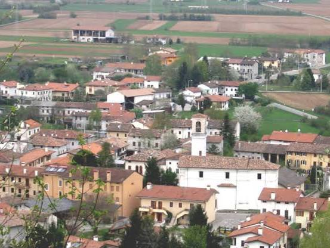
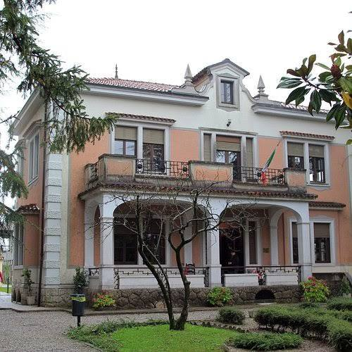
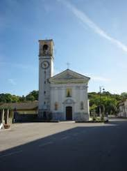
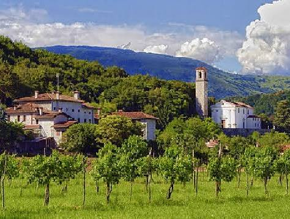
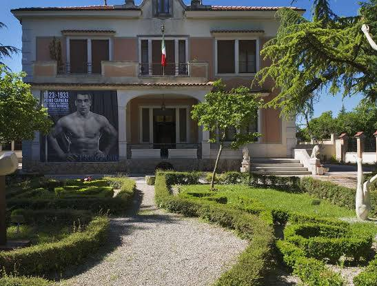
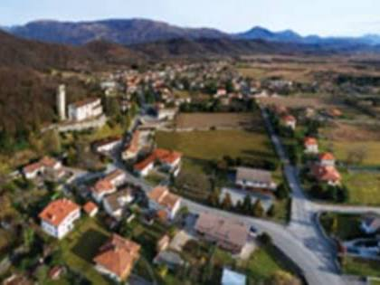
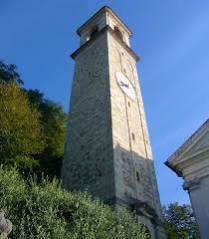

# Sequals Commune Information

Captured: 2026-11-01T20:16:47.514Z

Source: https://www.google.com/search?sca_esv=96f59e00825062f8&sxsrf=AKL5yDhJA2mgGdYV2AIKQguqHDoAFjM1rQ%3A1793533283403&vsint=&ntc=1&cs=1&sa=X&ved=0CBMQ2_wOahgKEwiQzpH4gOeXAxUAAAAAHQAAAAAQpAE&biw=1707&bih=898&dpr=1.5&udm=50&atvm=1&mstk=AUtExfASnu_8N5M0ILEgYZxhm8vctvKS0Xj2L2j495MPXMyLW-Gl7Td-J0Mj-Amjw7vq0CUP3kbAqWSC1oqUSp_ct2dZLFHkTkAY9mvSGLFmyL2g-hgQrqNjLf8ZYPRjwsmMclQxNL8mbg9L8gPdqUhxIic-fbB_7Wfz3WM&mtid=s0Lnao_zLcW79u8P9oHK6Qc&csuir=1&aep=26&q=sequals

## Prompt 1 — You

sequals

## Response 1 — Google AI Mode

"Sequals" most commonly refers to **Sequals, a historic commune (municipality) located in the province of Pordenone** within the northeastern Italian region of Friuli-Venezia Giulia. 

Wikipedia

Alternatively, if you meant **"sequels"** (with an "e"), it is the plural form of a literary, cinematic, or televised work that continues a narrative from a previous piece. 

Merriam-Webster

---

### 🇮🇹 The Italian Commune: Sequals

Sequals is a quiet, picturesque town of roughly 2,100 residents. It is particularly famous for its rich connection to arts, sports, and regional gastronomy: 

Wikipedia +1

* **The Mosaic Tradition:** Sequals is renowned for producing world-class mosaic and terrazzo artists who traveled globally. Most notably, it was the birthplace of **Giandomenico Facchina** (1826–1903), the artist who revolutionized mosaic techniques and decorated landmarks like the Opéra Garnier in Paris. 

  Wikipedia
* **Primo Carnera:** The town was home to **Primo Carnera** (1906–1967), the iconic heavyweight boxing champion of the world ("The Ambling Alp"). Visitors today frequently tour [Villa Carnera](https://www.comune.sequals.pn.it/), his beautifully preserved 1930s-era family home. 

  Comune di Sequals +2
* **Local Attractions:** Beyond the villa, the area features local vineyards, the ancient ruins of the *Castello di Solimbergo*, and distinct regional cuisine such as *Blecs* (a traditional buckwheat-cornmeal pasta). 

  Tripadvisor +1

---

### 🎬 The Media Term: Sequels (Misspelling)

If you are looking for information regarding **media continuations**, the correct spelling is *sequel* / *sequels*. 

Merriam-Webster

* **Definition:** A creative work that expands upon the timeline or story of a preceding original work.
* **Examples:** Famous cinematic follow-ups include *The Godfather Part II*, *Terminator 2: Judgment Day*, or *Toy Story 3*. 

  Merriam-Webster +1

Are you researching the **Italian town of Sequals** (perhaps looking for travel tips or history), or were you looking for information regarding **movie, book, or video game sequels**?

### Source links

- [en.wikipedia.org](https://en.wikipedia.org/wiki/Sequals)
- [www.merriam-webster.com](https://www.merriam-webster.com/dictionary/sequel)
- [nl.wikipedia.org](https://nl.wikipedia.org/wiki/Sequals)
- [www.comune.sequals.pn.it](https://www.comune.sequals.pn.it/)
- [www.tripadvisor.com](https://www.tripadvisor.com/Attractions-g1600478-Activities-Sequals_Province_of_Pordenone_Friuli_Venezia_Giulia.html)
