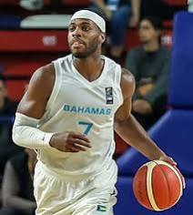
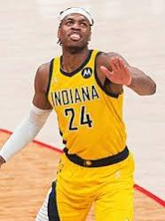
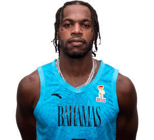
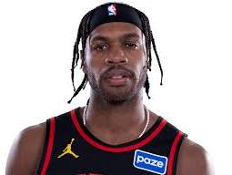
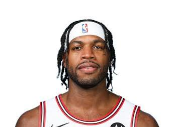
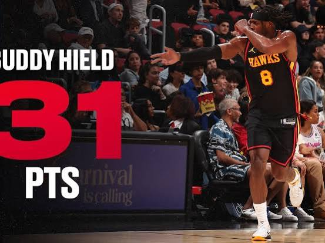
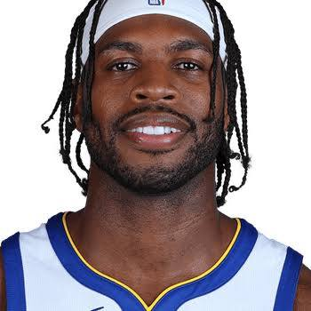
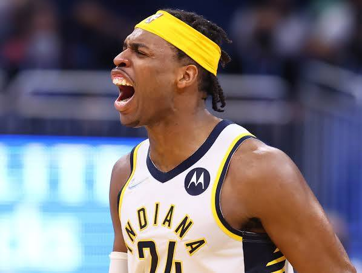

# Buddy Hield

Captured: 2026-11-01T20:18:38.752Z

Source: https://www.google.com/search?sca_esv=96f59e00825062f8&sxsrf=AKL5yDhJA2mgGdYV2AIKQguqHDoAFjM1rQ%3A1793533283403&vsint=&ntc=1&cs=1&sa=X&ved=0CAEQ2_wOahgKEwiAxrnxyueXAxUAAAAAHQAAAAAQigU&biw=1707&bih=898&dpr=1.5&udm=50&atvm=2&mstk=AUtExfCKuAIe3i_G7rp6aUpq9N2YAqR93rILFZgfdiOsQG1dDZzi-5rRhqAjKK6HykspcaKcKVtYTTysfeAOrKRAmyd0IlabylEFGLPyQC_aFiQ2WtIx1QD_MVEwwFCojemSIkjoU2iRmSFsU8L5NhpvJAxu_6xnwrm8wU1L0aekk_ThhKfBXatWl7Si3P0dn87xtIsE6Kd23y9_lhRcDjbVdyOiOqAvYuzCdPMhh-FCUS_6MMBvh1y57xZ9_WaSWfdQnLONBUG8Q1aKbQ&mtid=uEPnauaDFuGti-gP4-ub0AE&csuir=1&aep=26&q=hield

## Prompt 1 — You

hield

## Response 1 — Google AI Mode

**Buddy Hield** (Chavano Rainier Hield) is a Bahamian professional basketball player who plays as a shooting guard for the **Chicago Bulls** in the NBA. Known as one of the league's most prolific three-point shooters, he was originally drafted 6th overall in the 2016 NBA Draft by the New Orleans Pelicans. 

Wikipedia +1

### 🏀 2026–27 Season & Career Overview

* **Current Team:** [Chicago Bulls](https://www.nba.com/bulls) (#7) 

  ESPN +1
* **Recent Journey:** Hield has had a highly active journey over the last few seasons. After playing for the Indiana Pacers, Philadelphia 76ers, and the Golden State Warriors, he briefly landed with the Atlanta Hawks in early 2026 before being traded via the Hornets to the Bulls in September 2026. 

  NBA.com +1
* **Role & Stats:** In the opening games of the 2026–27 season, Hield has been utilized as a weapon off the bench, averaging 6.3 points and 1.8 assists per game. 

  ESPN +1

### 🏆 Career Highlights

* **College Stardom:** Played for Oklahoma (2012–2016), sweeping the national consensus player of the year honors in 2016 (Wooden, Naismith, Oscar Robertson awards).
* **NBA Accolades:** NBA All-Rookie First Team (2017) and NBA Three-Point Contest Champion (2020).
* **International:** Proudly represents the Bahamas National Basketball Team in international competitions. 

  Wikipedia

---

*Note: If you are looking for the word **"hield"** outside of basketball, it is also the Dutch past-tense singular form of the verb "houden" (meaning "held" or "kept"), or an archaic English dictionary term meaning to tilt or lean.* 

WikiWoordenboek +1

Are you looking for something specific about Buddy Hield, such as his **game logs**, his **contract details**, or his **fantasy outlook** for this season?

### Source links

- [en.wikipedia.org](https://en.wikipedia.org/wiki/Buddy_Hield)
- [Chicago Bulls](https://www.nba.com/bulls)
- [www.espn.com](https://www.espn.com/nba/player/_/id/2990984/buddy-hield)
- [www.nba.com](https://www.nba.com/player/1627741/buddy-hield)
- [nl.wiktionary.org](https://nl.wiktionary.org/wiki/hield)
