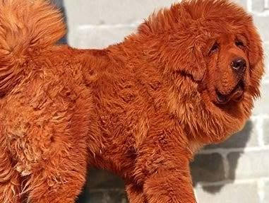
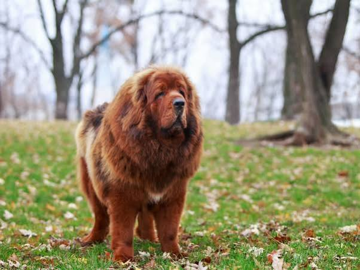
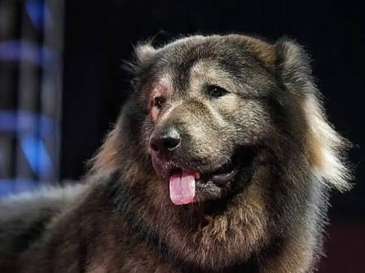
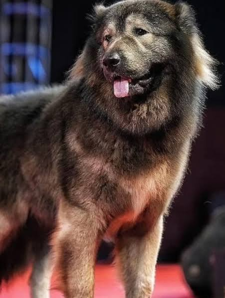

# Dure Dieren

Captured: 2026-11-01T20:18:23.375Z

Source: https://www.google.com/search?sca_esv=96f59e00825062f8&sxsrf=AKL5yDhJA2mgGdYV2AIKQguqHDoAFjM1rQ%3A1793533283403&vsint=&ntc=1&cs=1&sa=X&ved=0CDcQ2_wOahcKEwiAxrnxyueXAxUAAAAAHQAAAAAQOA&biw=1707&bih=898&dpr=1.5&udm=50&atvm=2&mstk=AUtExfBpGBhvwQp9N0_nolHoii8Tm9VOxLbFy91xf1eMUiRsHmz7ZZtiC7gtlDpQLd_I4VuAcFTWA1v1a2690_0AFXZRP54TXHc7oWmxu7uX-Gr81PmC0_HSn5yAbxP9LdaeK1SmyuHOyKopMD1g0Y-mCXF3N3HM5VQ9Vw5YYYuwWbMlkgMo71c2KzdOuN8vEo0Sff1x5sbmGkOYKdyhw6uYbB9k30ykHamTqwMXd8YmQAe5BfnBuIcmXFnkPp7J_AUOluex4o7k9hp32vh90l2b1pAwSVpPSo2Gc1ON6CHnY69WL7_3Jk3JcNL-2E1GRHQZyXV82Kx6mOPnXQ&mtid=FkznatjoFeG3i-gPtsOamA0&csuir=1&aep=26&q=dural+dier

## Prompt 1 — You

dural dier

## Response 1 — Google AI Mode

Het lijkt erop dat er een typefout in je bericht staat. Bedoelde je misschien **duurste dier**?

Als je op zoek bent naar de meest kostbare dieren ter wereld, zijn dit een aantal van de absolute recordhouders:

* **De Tibetaanse Mastiff:** Dit hondenras geldt als een van de duurste huisdieren ter wereld. Er zijn exemplaren verkocht voor bedragen die oplopen tot **bijna 2 miljoen euro**. Onlangs werd er in India zelfs een Kaukasische herdershond (wolfshond) gekocht voor **5,3 miljoen euro**. 

  Jeugdjournaal +2
* **Arabische paarden:** Volbloed Arabische paarden met uitstekende bloedlijnen kunnen op veilingen tussen de **100.000 euro en 10 miljoen euro** opleveren. 

  YouTube·Discover Agriculture
* **Kleurrijke Koi-karpers:** Exclusieve kampioensvissen uit Japan wisselen soms voor meer dan **1 miljoen euro** van eigenaar. 

  Instagram·Top5expensive
* **De vliegend hert kever (Stag Beetle):** Voor zeldzame, grote exemplaren van deze insecten betalen verzamelaars soms wel **80.000 euro**. 

  YouTube·Discover Agriculture

Mocht je iets heel anders hebben bedoeld met **"dural dier"** (zoals het historische woord *duran* voor een das, of de dieren van de kunstenaar *Dürer*), laat het dan gerust weten! Wat zocht je precies? 

Volkoomen.nl +1

### Source links

- [jeugdjournaal.nl](https://jeugdjournaal.nl/artikel/2560305-duurste-hond-ter-wereld-verkocht-voor-5-3-miljoen-euro)
- [www.youtube.com](https://www.youtube.com/watch?v=PNmdumLz9IY&vl=en&t=11)
- [www.instagram.com](https://www.instagram.com/reel/DeaS-MHtMqN/)
- [volkoomen.nl](https://volkoomen.nl/dieren/das)

## Prompt 2 — You

phoenetisch verkeerde gespelt pin evengoed

## Response 2 — Google AI Mode

Ah, je bedoelde **"duur aldi-er"** ofwel het **duurste dier bij de Aldi**! 🐧

De Aldi staat natuurlijk bekend om zijn budgetvriendelijke prijzen, maar ze hebben af en toe unieke acties of non-food artikelen die de kroon spannen.

Als we kijken naar de "dieren" die je bij de Aldi kunt kopen, zijn dit de absolute toppers qua prijs:

* **De XL Pluche Knuffels:** Tijdens de feestdagen verkoopt Aldi vaak reusachtige pluche beren of pinguïns van meer dan een meter hoog. Deze kosten meestal rond de **€25,- tot €35,-**.
* **Luxe Vers Vlees:** Rond Kerstmis vind je in de koeling de duurdere dierlijke producten, zoals een hele **hertenbiefstuk**, **eendenborstfilet** of een luxe **kalkoen**. Deze actieproducten kosten vaak tussen de **€15,- en €30,-** per kilo.
* **Robot-speelgoeddieren:** In de wekelijkse aanbiedingsbakken (Aldi Hits) zitten soms interactieve robothonden of -katten. Die gaan vaak voor zo'n **€20,- tot €30,-** over de toonbank.

Dus het allerduurste "dier" bij de Aldi is waarschijnlijk een gigantische pluche pinguïn of een premium stuk hertenbiefstuk voor het kerstdiner!

Was je toevallig op zoek naar een **specifiek dierenspeeltje** of een **bepaald product** uit de huidige Aldi-folder? Laat het me weten, dan zoek ik gericht met je mee!
