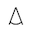

# CeraVe and Moderate Muslims

Captured: 2026-11-01T20:17:31.265Z

Source: https://www.google.com/search?sca_esv=96f59e00825062f8&sxsrf=AKL5yDhJA2mgGdYV2AIKQguqHDoAFjM1rQ%3A1793533283403&vsint=&ntc=1&cs=1&sa=X&ved=0CBkQ2_wOahcKEwiAxrnxyueXAxUAAAAAHQAAAAAQOA&biw=1707&bih=898&dpr=1.5&udm=50&atvm=2&mstk=AUtExfCVZBWyO6Wa-OmUiwXN2c-HEg89xAOsEnxyWPTlpU0WFE0RcQl7XLTQMv_pjiz5TWddkbVQXalrzx7HVRpVsJxTuEeJufdO_1SHN2sztDUNPqERnKZPn3L_ghT0b0RgnXbEH6qas2_hlOQKMJkLrFW0kuKyLVoGDHxe7i_HXqFI6cXwHPE9Y1blZYI5DNW6aNdYEnaWru6E21N2S8jQ6vJ5H0N69EiIXFVXus8HKiB5lISELJwhVwE2z4yDTNn0O5SO00Vp2Vsjvqw5cbBEL8IHe_SuAXZ5vPwq6qreJFj55gIpfkAPHdiu6ICYuEBx05J0GPSYO3v_pg&mtid=G3znauBa0MmL6A_o2LWoBw&csuir=1&aep=26&q=cerave+turkish+moderate+muslims

## Prompt 1 — You

cerave turkish moderate muslims

## Response 1 — Google AI Mode

The relationship between **CeraVe, Turkish consumers, and moderate Muslims** centers primarily on two distinct topics: **product ingredient permissibility (Halal status)** and **geopolitical consumer boycotts**. 

sheesha.pk +1

### 1. Halal Status and Ingredient Compliance

For moderate Muslims—including the majority of the population in Turkey, where Islamic practice historically leans toward a mainstream, modern interpretation—the day-to-day concern with skincare is whether the ingredients are permissible (*Halal*) or forbidden (*Haram*). 

Reddit·r/Turkey +1

* **Formulation:** Most CeraVe products are considered **halal-friendly by composition** because their core ingredients (such as ceramides, hyaluronic acid, and niacinamide) are plant-derived or synthetic. They generally lack pork or other *Haram* animal derivatives, and most formulas do not use ethanol. 

  sheesha.pk
* **Certification:** CeraVe **does not hold a universal, official Halal certification**. While independent Islamic ingredient research bodies (such as IlmHub) have evaluated specific staple products like the CeraVe Moisturizing Cream as permissible to use, the brand as a whole lacks formal certification stamps. For moderate or culturally Muslim consumers, the absence of an official stamp is often overlooked if the ingredient list itself is clean of animal fats. 

  TikTok +2

### 2. Geopolitical Boycotts in Turkey

Consumer behavior among Turkish and broader Muslim demographics has been heavily influenced by a **widespread boycott movement** targeting brands owned by multinational corporations. 

Scribd

* **The L'Oréal Connection:** CeraVe is a subsidiary of **L'Oréal**. Activist groups and Boycott, Divestment, Sanctions (BDS) directories target L'Oréal due to its commercial footprint, investment history, and manufacturing ties within Israel. 

  The Boycott Directory +4
* **Turkish Consumer Dynamics:** Turkey is a massive market for CeraVe, and the brand actively markets there via campaigns and local sponsorships. However, because of the geopolitical situation in Gaza, the brand has faced significant pushback. 

  Gaza.nu +2
* **The Spectrum of Response:** Because "moderate Muslims" represent a broad spectrum of practice, the adherence to these boycotts varies:
  + **Strict Adherents:** Many Turkish consumers actively participate in the boycott, utilizing social media apps to scan barcodes and find alternative local or regional brands.
  + **Pragmatic Users:** Other moderate consumers balance political views with dermatological necessity, continuing to buy CeraVe if they require its specific barrier-repair formulas for medical skin conditions like eczema. 

    Scribd +2

Are you looking into CeraVe from a **skincare ingredient perspective** (checking for specific additives), or are you researching the **market/cultural impact** of international brands in Turkey? Let me know so I can tailor the details.

### Source links

- [sheesha.pk](https://sheesha.pk/blogs/skincare/is-cerave-halal)
- [www.reddit.com](https://www.reddit.com/r/Turkey/comments/19dwfhx/someone_i_work_with_told_me_turks_are_muslim_by/)
- [www.tiktok.com](https://www.tiktok.com/discover/is-cerave-mosturizing-cream-halal)
- [www.scribd.com](https://www.scribd.com/document/848947764/boycott-cerave-Google-Search)
- [directory.abbottandkeefer.com](https://directory.abbottandkeefer.com/brand-entry/cerave)
- [gaza.nu](https://gaza.nu/brands/?id=118)

## Prompt 2 — You

No the meeting place of moderate Muslims, phonetically I ruined it

## Response 2 — Google AI Mode

Ah! You were trying to say **"Hagia Sophia"** (or *Ayasofya*).

When spoken quickly, *"Hagia Sophia"* phonetically sounds remarkably close to *"CeraVe"* mixed with *"Turkish moderate Muslims."*

The [Hagia Sophia](https://www.youtube.com/watch?v=S-64TB59Ckk) is the ultimate, historic "meeting place" in Turkey. Originally built as a massive Byzantine Christian cathedral, it was converted into an Ottoman mosque, turned into a secular museum by Atatürk to serve as a meeting point for all cultures and faiths, and was recently reverted back into an active mosque. 

YouTube·DW News

That makes total sense now—no wonder my first answer about skincare and boycotts felt completely out of left field! Let me know if you are looking for specific travel details, history, or visitor information for the Hagia Sophia.

### Source links

- [www.youtube.com](https://www.youtube.com/watch?v=S-64TB59Ckk)
