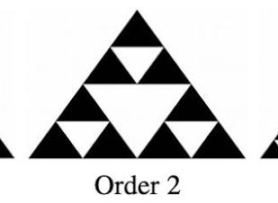
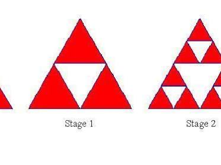

# Sierpinski Triangle Information

Captured: 2026-11-01T20:17:23.189Z

Source: https://www.google.com/search?sca_esv=96f59e00825062f8&sxsrf=AKL5yDhJA2mgGdYV2AIKQguqHDoAFjM1rQ%3A1793533283403&vsint=&ntc=1&cs=1&sa=X&ved=0CBMQ2_wOahcKEwiAxrnxyueXAxUAAAAAHQAAAAAQOA&biw=1707&bih=898&dpr=1.5&udm=50&atvm=2&mstk=AUtExfCjUvof_VYq3WLeQPvhzeSZTHMzem7krQYam45AFHVcjEvzyxAVJboBdgRCDkgLzBWb77BS_KV6uEoYXQsC695G-JRzuzfE1KhATxXbWq_vlBZid2COuTsPjno_YJ1n1M9LAV4_bnwYP7emXxMwur07nrqP8kRnmOmTgso0950UIzBdJnCB4oTnlCtmfl61LO6iqBI8jcPwM5AGGBL6sYWK5IDNh-o2LwsqBf8wA1CrisRfKTJNNzlJVPWJNseXBfHM0tUnl4kRTg7UNjesevSjIzdA9Om5fIxas_rh2LOuG2jRJhYxtxBwJ1z-Qdu4XqCpp6o3GcIF1Q&mtid=wX3naoytK96si-gP-ZacmAE&csuir=1&aep=26&q=this+is+THE+sierpinski+triangle

## Prompt 1 — You

this is THE sierpinski triangle

## Response 1 — Google AI Mode

The **Sierpiński triangle** is one of the most famous and captivating geometric fractals in mathematics. Named after the Polish mathematician [Wacław Sierpiński](https://en.wikipedia.org/wiki/Waclaw_Sierpinski), it features an overall structure composed of an equilateral triangle recursively subdivided into smaller equilateral triangles.





### Mind-Bending Fractal Properties

* **Infinite Perimeter:** If you add up the boundaries of all the remaining upside-down solid triangles at an infinite iteration, the perimeter approaches **infinity**.
* **Zero Area:** Because you remove the middle quarter of each triangle at every single step, the total area remaining after infinite steps drops down to **zero**.
* **Fractional Dimension:** It doesn’t fit into our normal 1D or 2D worlds. Its official Hausdorff dimension is approximately **1.585** (specifically,  $\log \_{2}3$ ).

### How It Can Be Generated

1. **Subdivision (The Gasket Method):** Start with a solid equilateral triangle, find the midpoints of each side, and cut out the central upside-down triangle. Repeat this process infinitely for each remaining solid triangle.
2. **The Chaos Game:** Place three dots to form a triangle. Start at a random point, roll a three-sided die, and move exactly half the distance toward the corner rolled, leaving a tiny mark. Do this thousands of times, and the pattern beautifully self-assembles.
3. **Pascal's Triangle:** Write out the classic [Pascal's Triangle](https://mathigon.org/course/fractals/sierpinski) of binomial coefficients. If you color all the odd numbers black and leave the even numbers white, the Sierpiński triangle pattern emerges perfectly.

Would you like to play around with this fractal? I can generate an **interactive simulation** where you can adjust the generation depth, or we can look into the **Python code** to build one yourself!

### Source links

- [Wacław Sierpiński](https://en.wikipedia.org/wiki/Waclaw_Sierpinski)
- [Pascal's Triangle](https://mathigon.org/course/fractals/sierpinski)

## Prompt 2 — You

Last prompt was TI not the

## Response 2 — Google AI Mode

Ah, got it! My apologies for misreading **TI** as "THE."

You are referring to the **Texas Instruments (TI) graphing calculators** (like the classic TI-84 Plus, TI-89, or TI-Nspire) and their famous ability to generate the Sierpiński triangle!

Because of their programmable nature—specifically using **TI-BASIC**—students and programmers have been writing short scripts to render this exact fractal on their calculator screens for decades, usually using the "Chaos Game" method.

Here is the classic **TI-BASIC code** to generate the Sierpiński triangle on a standard TI-83/84 Plus graphing calculator:

text

```
:ClrDraw
:FnOff 
:PlotsOff
:0→Xmin:1→Xmax
:0→Ymin:1→Ymax
:AxesOff
:0.5→A:0→B
:0→C:1→D
:1→E:0→F
:0.5→X:0.5→Y
:For(I,1,3000)
:randInt(1,3)→K
:If K=1 Then
:0.5(X+A)→X:0.5(Y+B)→Y
:End
:If K=2 Then
:0.5(X+C)→X:0.5(Y+D)→Y
:End
:If K=3 Then
:0.5(X+E)→X:0.5(Y+F)→Y
:End
:Pt-On(X,Y)
:End
```

Use code with caution.

### How this TI-BASIC Program Works

* **Setup (`:0→Xmin`...):** It clears the graph screen, turns off any active functions or stat plots, and sets a clean 1 × 1 coordinate window without axes.
* **The Vertices (`:A` through `:F`):** It defines the three corners of the main triangle: (0.5, 0), (0, 1), and (1, 0).
* **The Loop (`:For(I,1,3000)`):** It runs the "Chaos Game" algorithm 3,000 times. Every iteration, it picks a random corner (`randInt(1,3)`) and moves the drawing pixel (`X,Y`) exactly halfway closer to that corner before plotting a point (`Pt-On`).

Would you like me to create an **interactive widget** right here that simulates how a TI calculator slowly plots these points line by line, or do you need help **inputting this specific code** into your physical TI calculator?
