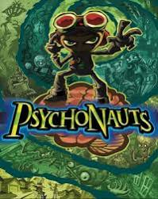
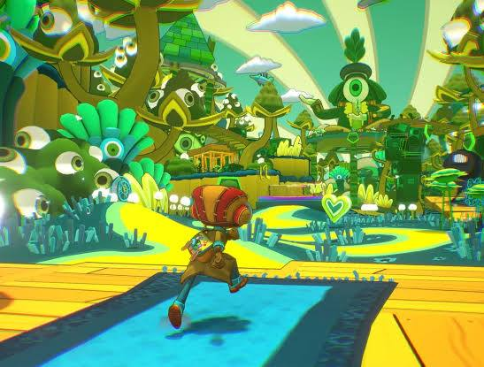
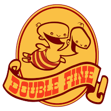
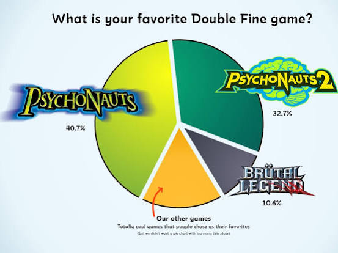
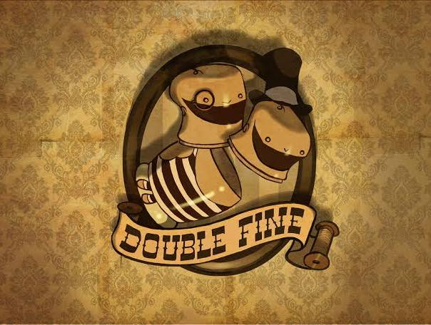

# Psychonauts Double Fine Studio

Captured: 2026-11-02T06:09:49.065Z

Source: https://www.google.com/search?sca_esv=b07e9e4d0de791f4&sxsrf=AKL5yDhjqDTvCTE8trvwzVHNiLaLGYQ3IQ%3A1793599161913&vsint=&ntc=1&cs=1&sa=X&ved=0CBMQ2_wOahgKEwiYnIPTz-iXAxUAAAAAHQAAAAAQmAE&biw=1707&bih=898&dpr=1.5&udm=50&atvm=2&mstk=AUtExfB4-CizjdFyot48RSrpEd-LkR-Ux0T0lOL0MWOyShZlnIeXrNJTg7iKAeJ0m6mEfxwVXX2cfN9MFwrUpQwxrxlKW9iR2ffCCVec3_g0YQ7OspXlgz31d78Loy8MnY5fMi60puNA5E3AOnOnbiAFJJFd3hhtWFcXxpOL9wo4y2pUANiljMb2P5E9kH6Vf1ic3KA0daEY--5DEcuaI-bHa04nvEs4sBEqkZpZVRg9F-fSq8WIrojdcXwOqA-5cm44vFh9nSmRsbA_tK3a2mwBU0gSsJz7leNfUEgesHynFH4p9fgVNcjNhbskQg3-H-ku6lpmYY9-_xSmQw&mtid=Mh7oao3BNcSK9u8P9quYsA4&csuir=1&aep=26&q=psychonauts+double+fine+studio

## Prompt 1 — You

psychonauts double fine studio

## Response 1 — Google AI Mode

**Double Fine Productions** is an independent American video game development studio famously known for creating the critically acclaimed ***Psychonauts* series**. Founded in July 2000 by LucasArts veteran Tim Schafer, the studio spent two decades building a reputation for highly imaginative, narrative-driven, and stylistically bold games. 

Wikipedia +3

### The Psychonauts Franchise

* **Psychonauts (2005):** The studio's debut title follows Razputin "Raz" Aquato, a young psychic who runs away from the circus to infiltrate a psychic summer camp. Despite initially struggling commercially under publisher Majesco, it earned a massive cult following and is widely cited as one of the greatest video games ever made due to its brilliant writing and inventive "mental world" level design. 

  Double Fine Productions +1
* **Psychonauts in the Rhombus of Ruin (2017):** A first-person VR adventure game designed to bridge the narrative gap between the original game and its long-awaited sequel. 

  Double Fine Productions
* **Psychonauts 2 (2021):** A highly praised, full-scale sequel that expanded on Raz’s journey as he finally reaches Psychonauts headquarters, upgrading the original's combat, platforming, and progression systems. 

  Double Fine Productions·Double Fine +1

### Recent History & Current Status

After being acquired by Microsoft's Xbox Game Studios in 2019 to help secure the financial completion of *Psychonauts 2*, Double Fine experienced a brief corporate chapter. However, following structural shifts within Xbox, **Double Fine officially returned to independence in July 2026**. Along with reclaiming their status as an indie studio, they successfully re-acquired the full publishing and intellectual property rights to their games, including *Psychonauts 2*. 

Reddit·r/xbox +3

The studio continues to preserve its distinct development culture—popularized by projects like their *Amnesia Fortnight* prototype jams and the massive *Double Fine PsychOdyssey* documentary series—as they chart their next chapter on independent ground. 

Double Fine Productions +1

Are you looking for **gameplay help / walkthroughs** for *Psychonauts*, or would you like to know more about **Double Fine's upcoming games** like *Keeper*?

### Source links

- [en.wikipedia.org](https://en.wikipedia.org/wiki/Double_Fine)
- [www.doublefine.com](https://www.doublefine.com/games/psychonauts/making)
- [www.doublefine.com](https://www.doublefine.com/games)
- [www.doublefine.com](https://www.doublefine.com/dftv/25-years-of-double-fine-psychonauts-2-with-lauren-scott-and-ashley-esqueda)
- [www.reddit.com](https://www.reddit.com/r/xbox/comments/1vx29tj/double_fine_regains_psychonauts_2_keeper_and_kiln/)
- [www.doublefine.com](https://www.doublefine.com/about)
