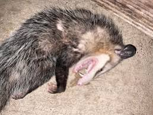
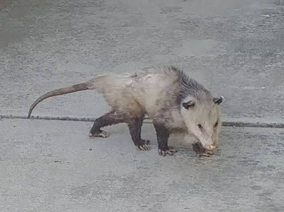
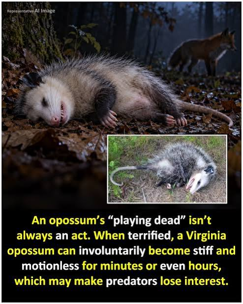
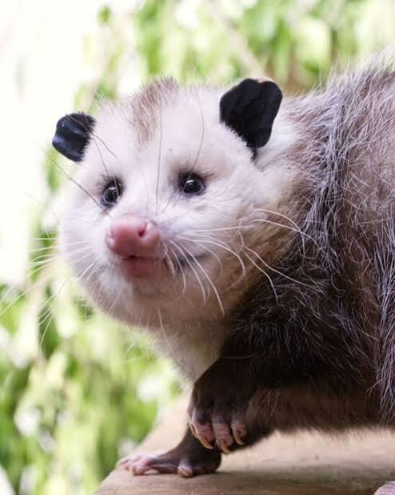
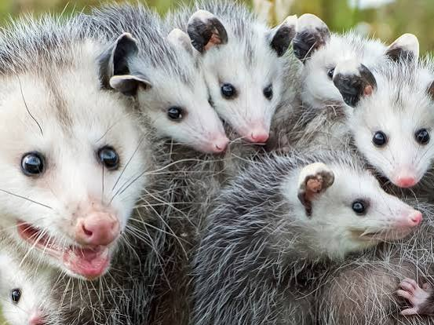
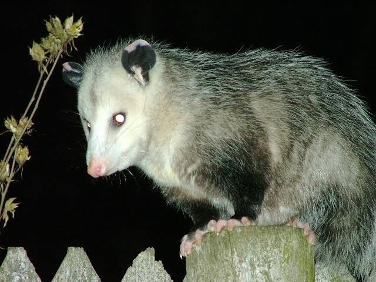
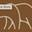
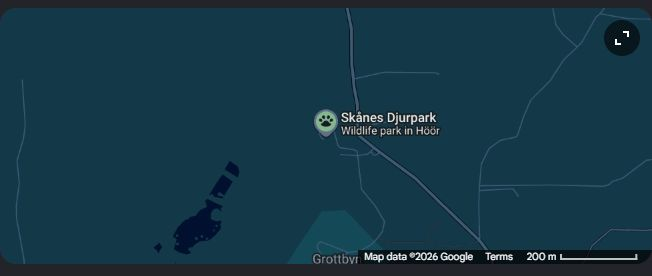

# Method Acting Opossum

Captured: 2026-11-02T08:50:37.171Z

Source: https://www.google.com/search?sca_esv=a6e9917f60d18831&sxsrf=AKL5yDg3QvC9dOxGSmpEMm4rJ0NULr9O1Q%3A1793601168939&vsint=&ntc=1&cs=1&sa=X&ved=0CCUQ2_wOahgKEwjwgdTS8-iXAxUAAAAAHQAAAAAQmwQ&biw=1707&bih=842&dpr=1.5&udm=50&atvm=2&mstk=AUtExfD2xPrUZNid3bZplk4lhI70DMZuaogyBqMNDOOTOMwz8qmpalBw66P5U429p6KoIuoZqi_qeutQnyeIu5rVvLc7MDNZEo6xnhdWqQDokOcnTzie59N4wiIIftitx6ReAVVwTpm1VswPeXjc8dDuHpiaOmGYJXflvlyZvEnc8y4H2Hzpx5qv9qg3xWAJEQPsKvV3aHyeRJu7Yv9c_BPDfiarI3Mg86juEktk4yICtCfnn4x8aCwdB9ye7_1mqn7E_mdFZHXkxg_A9eIO6v2TatKXcp95A9AMDVUfLLCScH2uZku2gD_oNn6lSLoGYqv-OhdsAFoEBYF-jw&mtid=sjboarWrINa9i-gPmsyGgQU&csuir=1&aep=26&q=method+acting+opossum

## Prompt 1 — You

method acting opossum

## Response 1 — Google AI Mode

Calling an opossum a "method actor" is a popular internet joke, but **their famous ability to "play dead" is actually an involuntary physiological shutdown called thanatosis, not a conscious performance**. When a Virginia opossum experiences extreme fear or stress, its brain completely short-circuits, forcing it into a comatose-like catatonic state that can last anywhere from a few minutes to several hours. 

Facebook·Ontario Ministry of Natural Resources +3

While it looks like a theatrical masterpiece, the animal has absolutely no control over the behavior. 

Facebook +1

### The "Commitment" to the Craft

If it *were* an acting gig, the opossum would easily win an Oscar for its absolute commitment to the scene. During thanatosis, their body undergoes an intense transformation to mimic a decaying corpse: 

www.grunge.com +2

* **The Rigor Mortis Look:** They roll onto their back, go completely stiff or limp, and curl their paws.
* **The Dead Stare:** Their eyes glaze over and stay wide open, staring blankly into space.
* **The Drool & Tongue:** Their mouth hangs open, their tongue sticks out, and they begin to foam at the mouth.
* **The Smell Test:** To seal the deal, their anal glands secrete a putrid, foul-smelling green fluid that reeks of rotting meat. 

  Facebook·Sacramento Zoo +2

### Real-World Discussion

On platforms like [Reddit](https://www.reddit.com/r/todayilearned/comments/uy8onv/til_that_possums_dont_play_dead_they_actually/), opinions are mixed regarding how to classify this behavior; some users point out that it resembles a seizure-like state, while others argue that because it functions perfectly to deceive predators, "playing dead" remains an accurate description. 

Reddit·r/todayilearned +1

Unfortunately, this evolutionary masterstroke backfires in the modern world. When confronted by oncoming traffic, an opossum's instinctual fear response causes it to freeze dead on the tarmac, frequently leading to roadkill. 

Wikipedia +1

Are you looking up the "method acting" opossum because of a **specific meme or video** you saw, or are you just interested in the **weird science** behind how they survive?

### Source links

- [www.facebook.com](https://www.facebook.com/ONresources/posts/and-the-award-for-best-performance-by-an-actor-goes-tothe-opossumwhen-threatened/1458891056433961/)
- [www.facebook.com](https://www.facebook.com/DefendersofWildlife/posts/did-you-know-that-opossums-dont-choose-to-play-dead-theyre-actually-entering-a-s/1339746951530035/)
- [www.grunge.com](https://www.grunge.com/1121660/the-science-behind-why-opossums-play-dead/)
- [www.facebook.com](https://www.facebook.com/SacZoo/posts/this-actor-is-a-master-of-the-final-curtain-call-%EF%B8%8F-playing-possum-isnt-just-a-sa/1186733803482655/)
- [www.reddit.com](https://www.reddit.com/r/todayilearned/comments/uy8onv/til_that_possums_dont_play_dead_they_actually/)
- [en.wikipedia.org](https://en.wikipedia.org/wiki/Apparent_death)

## Prompt 2 — You

moose sweden skane

## Response 2 — Google AI Mode

If you are looking to see the "King of the Forest" (älg) in the southernmost region of Sweden (**Skåne**), you have a few excellent options. While wild moose do live throughout Sweden, they are less densely populated in the open plains of Skåne compared to the thick boreal forests of neighboring Småland. 

Holmstock Travel +1

To guarantee a close encounter, your best strategy is visiting one of Skåne’s dedicated parks, though a few wilderness spots offer a chance at wild sightings.

Map from the source conversation (static archival capture). Map data ©2026 Google; original terms link retained in the source markup.

### Top Dedicated Moose Parks in Skåne

* **Söderåsens Älgpark**: Located near Ljungbyhed, this specialized park offers a **guided tractor-pulled wagon safari** straight into a natural forest enclosure housing seven resident moose. It is widely considered the best spot in Skåne to get close enough to feed branches to the moose and touch them on their own terms. The venue features an outdoor grill, a cozy café, and a small area with African pygmy goats. It operates seasonally, typically from Easter through September, and online pre-booking is highly recommended. 

  Tripadvisor +4
* **Skånes Djurpark**: This is the world's largest park dedicated exclusively to **Nordic fauna**, spanning over 100 hectares of authentic wilderness in Höör. Rather than an interactive petting zoo, this park focuses on expansive, ethical enclosures where animals roam freely. You can view moose alongside wolves, bears, and lynx from a series of stunning treetop suspension bridges called *Expedition UPP*. Because the habitats are massive, finding the moose requires patience—bringing a pair of binoculars is highly recommended. 

  Google

### Where to Spot Wild Moose in Skåne

If you prefer tracking a wild moose in its natural habitat, you need to head to the denser woodlands and marshy areas of northern Skåne: 

nordicwilderness.se

* **Djurholmamossen:** Located on the Hallandsåsen ridge near Ängelholm, this natural marshland and nature reserve is a known hotspot for wild moose foraging on birch and willow. 

  nordicwilderness.se +1
* **The Golden Hours:** Wild moose are notoriously shy and elusive. Your best chance of spotting one is by driving or hiking quietly through forested backroads at **twilight** (either dawn or dusk), when they emerge from deep cover to feed. 

  Holmstock Travel

### Just North of the Border (Småland)

If you are willing to drive just an hour north of Skåne into **Småland** (Sweden's most moose-dense region), you will find: 

Holmstock Travel

* [Markaryd Älgsafari](https://www.smalandet.se/sv): A massive 15-hectare drive-through safari park where you can drive your own car (or take a train) through a forest where moose and American bison roam completely free. 

  Smålandet Markaryds Älgsafari

Are you planning a trip and looking for the **easiest option for kids**, or are you hoping to try your luck **spotting a truly wild moose** in the backcountry?

### Source links

- [holmstock.com](https://holmstock.com/en/pages/elanden-spotten-in-zweden-de-ultieme-gids)
- [Terms](https://www.google.com/intl/en-NL/help/terms_maps/)
- [www.skanesdjurpark.se](https://www.skanesdjurpark.se/)
- [www.tripadvisor.com](https://www.tripadvisor.com/Attraction_Review-g3168169-d23365773-Reviews-Soderasens_Algpark_moosepark-Kagerod_Skane_County.html)
- [nordicwilderness.se](https://nordicwilderness.se/wildlife/moose)
- [Markaryd Älgsafari](https://www.smalandet.se/sv)
- [www.smalandet.se](https://www.smalandet.se/en/safari/park)

## Prompt 3 — You

windshield cars in the previous prompt and first

## Response 3 — Google AI Mode

### Opossums & Windshields (First Prompt)

While the first response did not explicitly mention windshields, cars play a central role in both topics:

* **The Involuntary Tarmac Freeze:** The first prompt noted that an opossum's extreme fear response causes it to lock up, frequently leading to roadkill when confronted by oncoming traffic.
* **The Internet Connection:** Beyond traffic, there are a couple of viral overlaps. A popular video features an opossum sprinting furiously across a car windshield to stay in place as a heavy sheet of snow slides down the glass. Additionally, custom-made [opossum windshield sunshades](https://www.etsy.com/market/possum_windshield_covers) depicting families of opossums driving cars are widely sold online. 

  Facebook·Vu Bros +1

### Moose & Windshields in Sweden (Previous Prompt)

The connection between moose, cars, and windshields in Sweden is a major engineering and safety topic:

* **The "Moose Test" Reality:** Because moose have long, spindly legs and heavy bodies (often weighing 300–700 kg), hitting one at high speed means the car's bumper clips their legs, causing the massive torso to roll directly onto the hood and smash straight through the windshield. 

  Facebook·QI - Quite Interesting
* **Swedish Engineering Solutions:** To counteract this specific threat, Swedish car manufacturers like [Volvo](https://www.volvocars.com/intl/news/the-day-adam-hit-a-moose-his-xc60-kept-him-unharmed/) and Saab heavily reinforce their vehicles' roofs and front A-pillars. Engineers in Sweden even won an Ig Nobel Prize for developing a complex rubber "moose crash-test dummy" specifically to test how well windshields and cabin frames withstand these terrifying impacts. 

  KTH +3

Were you trying to remember a **specific video** of an animal on a car windshield, or are you looking into the **automotive safety tests** used for large animal collisions?

### Source links

- [opossum windshield sunshades](https://www.etsy.com/market/possum_windshield_covers)
- [www.facebook.com](https://www.facebook.com/thevubros/videos/opossum-vs-snow-slide-the-ultimate-treadmill/1381980570364653/)
- [www.facebook.com](https://www.facebook.com/OfficialQI/posts/swedish-built-cars-saabs-volvos-are-specifically-reinforced-so-that-the-occupant/4973772919303871/)
- [Volvo](https://www.volvocars.com/intl/news/the-day-adam-hit-a-moose-his-xc60-kept-him-unharmed/)
- [www.kth.se](https://www.kth.se/en/om/nyheter/centrala-nyheter/algkrock-docka-gor-sen-succe-1.1193919)
