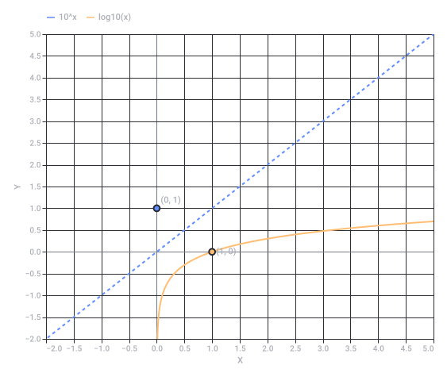

# Solve Logarithmic Equation

Captured: 2026-11-02T08:51:16.851Z

Source: https://www.google.com/search?sca_esv=a6e9917f60d18831&sxsrf=AKL5yDg3QvC9dOxGSmpEMm4rJ0NULr9O1Q%3A1793601168939&vsint=&ntc=1&cs=1&sa=X&ved=0CBMQ2_wOahgKEwjwgdTS8-iXAxUAAAAAHQAAAAAQmwQ&biw=1707&bih=842&dpr=1.5&udm=50&atvm=2&mstk=AUtExfCi3HjiFxN2ouMxjPO5Qg5j_bp5sZMRaQPOFiw-4623f4mVuAQ5-i33Reh2RmNulqUbf2zOj_Sdhs68x8C4mW98QECpxqbMyyNEWzcp9ESQmPMHMbxdts_AoM1wvFssCKpRVncobkv9YZDxhAYAp8i15qkmGwr3hQyoD2I_-jxMHOnZTTp8eMBAO44YWmCNxdZvztgfuqwzUZ9bazewe2XX8a8Iqykq4laheCVzItqAwUnZ105mpaoVbNkXgfrnDu5z5WdvTF7v6RpTvm_zX6ddpV66r7X4ImXNHKRAUhNTX6QD_QIHPPM-q32Q4FVddvsRqdddcysW_w&mtid=q0foataYObT4i-gPkL_b0A4&csuir=1&aep=26&q=%5E-1+%3D+log%281%29

## Prompt 1 — You

^-1 = log(1)

## Response 1 — Google AI Mode

This statement is **mathematically incorrect** (or has no solution), depending on how it is interpreted.

Here is the breakdown of why based on the two most likely meanings:

### Interpretation 1: Solving for an unknown variable ( $x^{-1} = \log(1)$ )

If you are trying to solve for a missing base or variable x:

* $\log(1) = 0$  (because any number to the power of 0 equals 1).
* This rewrites the equation as:  **$\frac{1}{x} = 0$**
* **Result:** **No solution**. There is no number you can divide 1 by to get exactly 0.

### Interpretation 2: Evaluating a statement ( $1^{-1} = \log(1)$ )

If you are checking if 1 to the negative first power equals the logarithm of 1:

* Left side:  $1^{-1} = \frac{1}{1} = 1$
* Right side:  $\log(1) = 0$
* **Result:** **False**, because 1 ≠ 0.

---

If you were trying to solve a specific problem or if this was a typo from a textbook, let me know **what the original problem was** or **what you are trying to calculate**, and I can help you find the right steps!

## Prompt 2 — You

^-1 == 1log(1)

## Response 2 — Google AI Mode

This statement is **mathematically incorrect**.

Here is how both sides evaluate:

* **Left side (1⁻¹):** Any number to the negative first power is its reciprocal.  $1^{-1} = \frac{1}{1} =$  **1**
* **Right side ( $1 \cdot \log(1)$ ):** The logarithm of 1 in any base is always 0. Multiplying it by 1 gives 1 ⋅ 0 = **0**

Since **1 does not equal 0**, the statement is false.

---

If this was a typo or part of a larger equation, let me know:

* What **variable** you are trying to solve for (like x or y)
* The **original calculus or algebra problem** you are working on

I can help you break down the correct steps!

## Prompt 3 — You

^-1 inv log

## Response 3 — Google AI Mode

It looks like you are mapping out different symbols for an **inverse logarithm**, but there is a slight conflict in how these notations work.

In mathematics,  **$\log^{-1}(x)$**  is the official notation for the inverse logarithm (also called the antilogarithm), which is simply an **exponent**.

Here is how the notation translates into actual math depending on the base of your logarithm:

### 1. Base 10 (Common Logarithm)

If you see  $\log^{-1}(x)$ , it means you are undoing a base-10 log.

* **Formula:**  $\log^{-1}(x) = 10^x$
* **Example:** If  $\log(100) = 2$ , then  $\log^{-1}(2) = 10^2 = 100$ .

### 2. Base e (Natural Logarithm, $\ln $ )

If you are working with the natural log, the inverse is written as  $\ln^{-1}(x)$ .

* **Formula:**  $\ln^{-1}(x) = e^x$
* **Example:** If  $\ln(single\text{ number}) = 1$ , then  $\ln^{-1}(1) = e^1 \approx 2.718$ .

### ⚠️ Why "⁻¹" does NOT mean " $\frac{1}{\log }$ "

In your previous notes, you used the negative exponent (⁻¹) to mean a reciprocal (like  $1^{-1} = \frac{1}{1}$ ). While that works for normal numbers, **in function notation, the ⁻¹ means "inverse function," not a reciprocal.**

* $\log^{-1}(x)$  means  **$10^{x}$**  (The inverse function).
* $\frac{1}{\log (x)}$  is completely different and is written as  $(\log(x))^{-1}$ .

---

Are you trying to **solve a specific equation** using an inverse log, or are you looking at a specific **calculator button**? Let me know what you're working on so we can get the right answer!

## Prompt 4 — You

yes but ^-1 inv == log(x)

## Response 4 — Google AI Mode

It looks like we are getting close to what you are visualizing, but the mathematical notation is slightly flipped.

The correct relationship is that **the inverse of a logarithm is an exponent, not the other way around.**

Here is exactly how the notation maps out:

* **$\log(x)$**  is the function.
* **$\text{inv }\log(x)$**  (or  $\log^{-1}(x)$ ) is its **inverse**.
* The actual mathematical operation that solves it is  **$10^{x}$** .

So, the true equation looks like this:   
 $\log ^{-1}(x)=\text{inv\ }\log (x)=10^{x}$

### Visualizing the Inverse Relationship

A function and its inverse completely undo each other. Think of it like a mirror reflection across the diagonal line y = x.

### Why the order matters:

If you take the log of a number, and then apply the inverse log, you get back to your original number:   
 $\log ^{-1}(\log (x))=x$

---

Are you trying to **isolate a variable** from inside a log function right now? If you paste the equation you are working on, we can apply this inverse tool together step-by-step!

Original source diagram: Logarithmic Function vs. Its Inverse Exponent Function

Recorded diagram labels and controls: Logarithmic Function vs. Its Inverse Exponent Function −2.0 −1.5 −1.0 −0.5 0.0 0.5 1.0 1.5 2.0 2.5 3.0 3.5 4.0 4.5 5.0 X −2.0 −1.0 0.0 1.0 2.0 3.0 4.0 5.0 −1.5 −0.5 0.5 1.5 2.5 3.5 4.5 Y (1, 0) (0, 1) 10^x log10(x)

## Prompt 5 — You

yes but the first prompt was missing an extra = which meant equals

## Response 5 — Google AI Mode

Ah, I see exactly what happened now! Thank you for clarifying. You were using `^-1` to mean **inverse**, and with the missing `=`, the notation got scrambled.

You were stating the identity definition: **the inverse of a logarithm equals the original input variable/value.**

When you write it out with the correct formatting, your logic is absolutely spot-on:

$\text{inv}(\log (x))=x$   
 $\text{log}^{-1}(\log (x))=x$

They completely cancel each other out, leaving you with just the x.

---

Now that we have the notation aligned, what **equation or problem** are you trying to solve using this inverse rule? Paste it in and we can knock it out!
