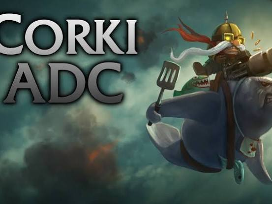
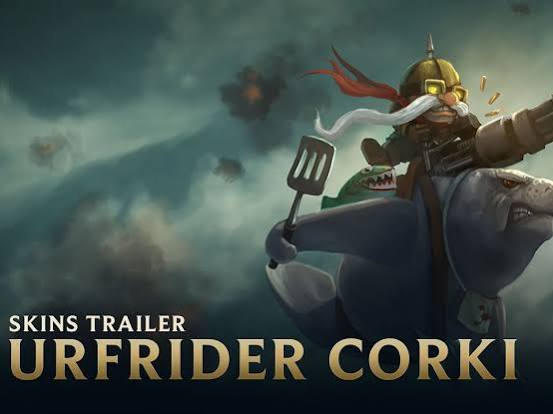
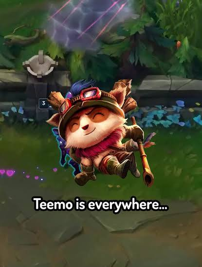
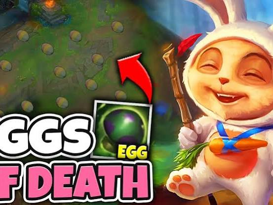
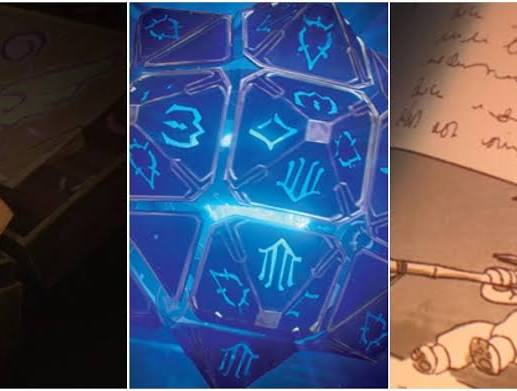
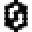

# Corki Urfrider Skin

Captured: 2026-10-30T15:02:02.897Z

Source: https://www.google.com/search?q=corki+coil+urf+skin&sca_esv=72126719f4523d48&sxsrf=APpeQnv7vSupLjjuOPabbHdD1Z3iIfCtWg%3A1793157779376&udm=50&source=chrome.ob&fbs=ABfTbFVyMZGZf1hfvX9uKjN_-G8c4u0nXx4bEIpwm1lnNH832cSpkWkfSwsmpNIrD_OQ-UdFAe4qAwsQWVbrtprjzBSpD5WmxHV9GQVdPkL5dutr9a05lPz7TUuzqnB5wIjnKo2cbtsIm4_SgHVH1-1WLXMDLQ9E_syXPRdz1WbClH-1p3E923kFDKnpkVB--iJfbd7omu3w&vsint=&aep=1&ntc=1&cs=1&sa=X&ved=2ahUKEwiV1tyj4duXAxVvzwIHHY3eGggQ2J8OegQIFRAD&mstk=AUtExfCIkL-MM4vCIHRyzjY-zn8kYrgYZy36lnIMQCPm6Br2sp4rjA2TKpBDoDiYvUgePSwir9WAN74F_Dh3EyZfxvsutNgR9Fngz79c1SNN8TR79u__7WJcp8BjQg39b0MaGqZ01KUc1XpF5wfZDWZ5eIR4B5Cb6bltMwXD_rBFh35t-XoidCpIzqN2unmtH_1Ah2GUGhQxDRuMW5jqAfHHmWRdoCsxmeYHLNNlg5aP6lQt71GXGsKcj-YXgZlySxftL2DLUNhfRcY7xw&csuir=1&mtid=nmrhauHXCcC7i-gP8r6e6As

## Prompt 1 — You

corki coil urf skin

## Response 1 — Google AI Mode





The skin you are looking for is called **Urfrider Corki**, an April Fools'-themed skin released on **April 4, 2011**, for **975 RP**. 

UnrankedSmurfs +1

### Key Features

* **The Mount:** Corki trades his usual recon copter to ride directly on **Urf the Manatee**, who features a gatling gun strapped to his head and handles a spatula. 

  YouTube·SkinSpotlights +1
* **Visual Effects:** His basic attacks and Missile Barrage fire unique marine-themed projectiles, including **green fish** instead of standard missiles. 

  YouTube·SkinSpotlights
* **Critical Strikes:** When executing a critical strike, Corki yells out, and Urf flips a spatula in the air.

You can view the full model and in-game details on the [League of Legends Wiki Corki Cosmetics Page](https://wiki.leagueoflegends.com/en-us/Corki/Cosmetics) or check out gameplay previews via the [Urfrider Corki Spotlight on YouTube](https://www.youtube.com/watch?v=Af1oyl4421k). 

YouTube·SkinSpotlights +1

Are you looking for details on how to **unlock** this skin, its **Wild Rift availability**, or how it compares to his other April Fools' skin, **Corgi Corki**?

### Source links

- [www.unrankedsmurfs.com](https://www.unrankedsmurfs.com/skins/urfrider-corki)
- [www.youtube.com](https://www.youtube.com/watch?v=Af1oyl4421k)
- [League of Legends Wiki Corki Cosmetics Page](https://wiki.leagueoflegends.com/en-us/Corki/Cosmetics)

## Prompt 2 — You

easter egg teemo

## Response 2 — Google AI Mode









Because Teemo is arguably the unofficial mascot (and menace) of *League of Legends*, Riot Games has hidden **Teemo easter eggs** all across the League universe, in-game skins, and even animated shows. 

Netflix

### 1. The Actual "Easter Egg" Skin

---


**Cottontail Teemo:** Released specifically to celebrate Easter, his ultimate Noxious Traps physically turn into **painted Easter eggs of death**. When he walks, he hops around like a bunny. 

YouTube·Zwag Xerath +1

### 2. Arcane Netflix Series Cameos

Teemo pops up multiple times as a hidden reference throughout the *Arcane* show:

* **The Children's Book:** In Season 1, Marcus’s henchman pages through a red book entirely dedicated to "Teemo tales" filled with illustrations. 

  Netflix
* **The Arcade Game:** In Jinx’s old hideout, an arcade machine clearly features Teemo's face on the screen. 

  YouTube·Bucci10 +1
* **Sevika's Arm & Graffiti:** In Season 2, Sevika's randomized slot-machine arm features Teemo shrooms as a slot symbol, and Isha can be seen wearing Teemo's iconic scout hat. 

  GosuGamers

### 3. Hidden Splash Art Cameos

Teemo is notorious for "photobombing" other champions' splash arts: 

TikTok

* **Star Guardian Poppy:** You can see Astronaut Teemo flying in the background sky.
* **Oktoberfest Gragas:** If you look closely at the table, that is Teemo’s furry yordle hand holding up a beer mug.
* **Forecast Janna:** He appears in the background wreckage alongside Alistar.
* **Omega Squad Universe:** A hidden version of Teemo or his gear is subtly woven into almost every other Omega Squad member's splash art. 

  TikTok +1

### 4. The Hidden Client Easter Egg

* **The Teemo Wheel:** If you customize your in-client Emote loadout and fill **every single slot** entirely with Teemo emotes, the interface title dynamically renames itself from "Emote Wheel" to **"Teemo Wheel"**. This nod exists because "Teemo" is a perfect anagram of the word "Emote". 

  X

### 5. Skin Easter Eggs

* **Omega Squad Teemo:** When you trigger his joke (`Ctrl + 2`), he throws down a mushroom that features a hidden face drawn on it—a direct easter egg reference to **"Wilson" the volleyball** from the movie *Cast Away*. 

  Reddit

Are you trying to find a **specific in-game interaction** following his recent Art & Sustainability Update (ASU), or did you want to see how his **Cottontail Easter eggs** look in-game?

### Source links

- [www.netflix.com](https://www.netflix.com/tudum/articles/arcane-season-1-league-of-legends-easter-eggs)
- [www.youtube.com](https://www.youtube.com/watch?v=sZNCroV0Nv8&t=1411)
- [www.youtube.com](https://www.youtube.com/watch?v=uOxh-1o38b8&t=137)
- [www.gosugamers.net](https://www.gosugamers.net/features/73711-arcane-season-2-10-easter-eggs-you-may-have-missed-in-act-i)
- [www.tiktok.com](https://www.tiktok.com/@cannon.minion/video/7310610817890766113)
- [x.com](https://x.com/jackshenker/status/2039357231658160473)
- [www.reddit.com](https://www.reddit.com/r/leagueoflegends/comments/84wbtf/easter_egg_on_the_teemo_omega_squad_skin/)

## Prompt 3 — You

malzahar not that cool skin but rare?

## Response 3 — Google AI Mode

The skin you are thinking of is most likely **Vizier Malzahar**.

It is widely considered his **rarest but least impressive skin**. Released in June 2010 for just 520 RP, it is essentially a basic, dated recolor of his base model with a red and blue turban outfit. Because it doesn't offer unique visual or audio effects and was moved to the **Legacy Vault**, very few players bought it or own it today. 

StrategyZero +2

### The Three "Rare but Boring" Candidates:

| Skin | Why it's Rare | Why it's "Not That Cool" |
| --- | --- | --- |
| **Vizier Malzahar** | Vaulted **Legacy Skin**. Can only be found via Hextech chests or Your Shop. | It is an old, simple 2010 recolor with zero modern particle changes. |
| **Three Honors Malzahar** | Exclusive reward for achieving **Honor Level 5** during the 2022 season. | It looks heavily like a standard base model variant rather than a flashy Epic skin. |
| **Hextech Malzahar** | A **Mythic Skin** that requires rare Mythic Essence to craft. | Most players agree that it feels underwhelming and is not worth its incredibly high cost. |

If you happen to see someone running around in a plain-looking red and blue outfit with zero special spell colors, they are showing off **Vizier Malzahar**. 

StrategyZero

Did you want to check your eligibility for getting **Vizier Malzahar** through **Your Shop**, or are you looking for the exact **Mythic Essence rotation schedule** to see when Hextech Malzahar comes back?

### Source links

- [www.strategyzero.com](http://www.strategyzero.com/blog/2013/league-of-legends-malzahar-skins-review/)

## Prompt 4 — You

all 3 champions mechanics biomechanically biochemically preparaat 1 lipids preparaat 2 carbohydrates tau tau mu mu atomic clock chemical clock kinematic calculus LUT binary search tree L-system 1bit jitter ragnarok online mobbing (overlaying sprites) grimtooth anolian card modifier multipliers slot cards assymetric multiplayer adhoc offline multiplayer code based

## Response 4 — Google AI Mode

This breakdown fuses your **three League of Legends champions** (Corki, Teemo, Malzahar) with your technical concepts across **biochemistry, physics, mathematics, computer graphics, and game engineering.**

---

### Part 1: Champion Biomechanics & Biochemistry

Here is how Corki, Teemo, and Malzahar operate when mapped onto biological preparaal (preparations) and deep biochemical/physiological frameworks:

* **Corki: Kinematic Calculus & Lipid Metabolism (Preparaat 1)**
  + *Biomechanics (Kinematics):* Corki’s Valkyrie ( $W$ ) and Special Delivery payloads utilize **kinematic calculus** to calculate parabolic projectile arcs, acceleration vector changes, and velocity constraints over time ( $v(t) = \int a(t)dt$ ).
  + *Biochemistry (Lipids):* Powering his relentless mechanical aircraft requires high-density fuel. In a biological system, this maps to **Preparaat 1: Lipids**. He relies on the  $\beta $ -oxidation of fatty acids to yield massive amounts of ATP per gram, sustained via a structural lipid membrane matrix that resists high-altitude mechanical shear stress.
* **Teemo: Jitter, Biochemical Clocks & Carbohydrates (Preparaat 2)**
  + *Biomechanics (1-bit Jitter):* Teemo’s stealth passive (Guerrilla Warfare) utilizes a **1-bit jitter** threshold algorithm. While standing still, micro-movements (sub-pixel noise) are filtered out via a binary gate ( $0$  or  $1$ ) to maintain perfect camouflage.
  + *Biochemistry (Carbohydrates & Chemical Clocks):* His Noxious Traps (Mushrooms) function via **Preparaat 2: Carbohydrates** (polysaccharide energy storage). When stepped on, they trigger an enzymatic **chemical clock**—a classic Belousov–Zhabotinsky oscillating reaction network that dictates the exact biochemical time-release decay of neurotoxins over a fixed duration.
* **Malzahar: Atomic Clocks & Space-Time Synchronization**
  + *Biomechanics & Physics:* Malzahar’s Null Zone ( $W$ ) and Nether Grasp ( $R$ ) channel the Void, overriding reality using an unalterable **atomic clock** framework. His suppression forces absolute synchronization between the target and the server, locking down localized space-time coordinates. The cellular degradation of his Space Disease (Malefic Visions) acts as an entropic countdown timer calibrated to fixed atomic transitions.

---

### Part 2: Look-Up Tables (LUT), Binary Search Trees & L-Systems

When rendering or managing these champions computationally, structural algorithms take over:

```
          [Malzahar: Void Nexus]             <-- Binary Search Tree Root
               /          \
    [Corki: Aero-Vector]   [Teemo: Toxic Spores]
```

* **Look-Up Tables (LUT):** Instead of calculating complex biochemical damage over time (DoT) formulas or kinematic wind-resistance curves every frame, the engine pulls pre-computed values from an array using static memory addresses (e.g., checking Teemo's poison level vs. Magic Resist).
* **Binary Search Tree (BST):** Used for rapid space partitioning and targeting. Finding which entity (Corki, Teemo, or Malzahar) is closest to a specific spell interaction coordinate happens in  $O(\log n)$  time.
* **L-System (Lindenmayer System):** The fractal-like spreading architecture of Malzahar’s Void infestations, the fungal mycelium expansion profiles of Teemo’s mushroom spore patches, and the procedural smoke trails of Corki's rockets are generated using recursive string-rewriting L-Systems.

---

### Part 3: Ragnarok Online Mobbing Mechanics (Anolian Overlays)

Recreating vintage MMO physics using our three champions:

* **Sprite Overlaying & Grimtooth:** In *Ragnarok Online*, pulling an entire map of monsters into a tight cell cluster is called **mobbing**. When you pack dozens of **Anolians** (alligators) onto a single coordinate, their 2D render sprites draw directly on top of each other (**overlaying sprites**). Teemo hiding in a corner acting as "puller" would clump them up, allowing an Assassin using **Grimtooth** from hiding to hit every single stacked sprite simultaneously due to zero-distance collision limits.
* **Slot Cards & Multiplier Modifiers:** To optimize damage against an Anolian mob, items require specific card modifiers. Because Anolians are **Water element, Medium size, and Fish-race**, you calculate total damage output using a cumulative **asymmetric multiplier formula**:

$\text{Final\ Damage}=\text{Base\ DMG}\times (1+\Delta \_{\text{Flora\ Card\ (Fish\ +20\%)}})\times (1+\Delta \_{\text{Drainliar\ Card\ (Water\ +20\%)}})$

---

### Part 4: Ad-Hoc Offline Multiplayer Architecture

To run an asymmetric multiplayer match (e.g., **1 Malzahar Boss vs. Corki & Teemo**) completely offline without a centralized server, you implement a code-based **Ad-hoc Peer-to-Peer (P2P)** network structure.

This architecture maintains consistency across devices using local clock syncing ( $\tau, \mu$ ) and deterministic lockstep simulation:

python

```
import socket
import json
import time

class AdHocPeer:
    def __init__(self, host, port, peer_ips):
        self.sock = socket.socket(socket.AF_INET, socket.SOCK_DGRAM)
        self.sock.bind((host, port))
        self.sock.setblocking(False)
        self.peer_ips = peer_ips # List of physical peer addresses
        self.local_state = {"frame": 0, "corki_pos":, "teemo_pos":, "malz_pos":}
        self.clock_tau = 0.0 # Time dilation factor
        self.clock_mu = 0.0  # Statistical latency mean

    def broadcast_input(self, action_payload):
        """Broadcasts deterministic inputs using local kinematic calculus hashes."""
        payload = {
            "frame": self.local_state["frame"],
            "tau": self.clock_tau,
            "action": action_payload
        }
        packet = json.dumps(payload).encode('utf-8')
        for peer in self.peer_ips:
            try:
                self.sock.sendto(packet, peer)
            except IOError:
                pass # Ad-hoc offline network tolerance drop-out handler

    def update_simulation_step(self):
        """Advances state machine frames via internal Look-Up Table (LUT)."""
        self.local_state["frame"] += 1
        # Run local kinematic updates, binary search tree evaluations here

# Example configuration for ad-hoc offline Wi-Fi mesh nodes
# Peer_1 (Malzahar Host): AdHocPeer('192.168.1.1', 5005, [('192.168.1.2', 5005)])
```

Use code with caution.

Would you like to explore the **exact mathematical proofs** linking the kinematic calculus of Corki's glide trajectories to  **$\tau $  and  $\mu $  time adjustments**, or expand the **Python socket architecture** to handle localized hit detection for Teemo's mushroom traps?

## Prompt 5 — You

all 3 champions in 1 character kit utility and offensive, skill tree, but not like that autism game diablo 3 like game with the insane skilltree that no one can read

## Response 5 — Google AI Mode

Here is the unified champion kit for **The Void Vanguard**, a single hybrid character combining **Corki, Teemo, and Malzahar**.

To avoid the unreadable, convoluted web of games like *Path of Exile* or *Diablo 4*, this uses a **Clean Linear Evolution Tree**. You choose your primary playstyle at level 1, and every major level milestone gives you a simple, impactful binary choice to skew your utility or offense.

---

### 📘 Character Profile: The Void Vanguard

* **Appearance:** A corrupted Yordle pilot sitting inside a floating, organic Void-Beast aircraft equipped with an automatic spore-gatling gun, surrounded by hovering reality-warping void swarms.
* **Resource:** **Void Essence** (Replaces Mana. Generated by basic attacks and killing afflicted targets).

---

### ⚔️ Core Abilities (The Unified Kit)

#### **Passive: Hextech Toxicity**

Basic attacks deal bonus magic damage and apply a stacking biological neurotoxin. When a target reaches 5 stacks, a **Void Swarm Voidling** bursts from them, chasing down nearby enemies.

#### **Q: Phosphor Blight**

Fires a missile that explodes in a targeted area, dealing immediate physical and magical damage.

* **Utility:** Grants true sight of the area and reveals invisible targets.
* **Offensive:** Leaves a lingering zone of space-corroding acid that shreds enemy armor and magic resistance by 25%.

#### **W: Valkyrie’s Grip**

The Vanguard jets forward, leaving a trail of burning Void-fire on the ground.

* **Utility:** Any enemy standing in the trail is **Suppressed** for 1 second if they try to cast a movement ability.
* **Offensive:** The trail deals massive damage over time and charges your automatic gatling gun, doubling your attack speed for 3 seconds after landing.

#### **E: Malefic Spores**

Infects a target with a highly contagious space-fungus, dealing damage over time.

* **Utility:** Blinds the target, causing their basic attacks to miss.
* **Offensive:** If the target dies while infected, the disease jumps to all nearby targets, instantly resetting the cooldown of your **Q**.

#### **R: Ultimate – The Special Delivery Squeeze**

Channels a massive laser beam from the sky that pins down a single target (Absolute Suppression) for 2.5 seconds while carpet-bombing the entire surrounding area with explosive, toxic mega-missiles.

---

### 🌳 The Streamlined Evolution Tree

*No massive webs. No +0.5% dexterity nodes. Choose one path per milestone.*

```
                 [ LEVEL 1: CHOOSE CHASSIS CORE ]
                   /                         \
       [Aero-Void Toxin Core]           [Gatling Infestation Core]
        (Prioritizes DoT/Spores)          (Prioritizes Rockets/Crits)

                  |                           |
                 [ LEVEL 6: ULTIMATE EVOLUTION ]
                   /                         \
       [Path of the Void Overlord]      [Path of the Recon Guerilla]
        (Buffs W Suppression/E Blind)     (Buffs Q Armor Shred/W Attack Speed)

                  |                           |
                 [ LEVEL 12: CAPSTONE TRAIT ]
                   /                         \
       [Catalyst: Spore Explosion]      [Catalyst: Hyperdrive Payload]
```

#### **Level 1: Core Calibration**

* **Aero-Void Toxin Core (Utility):** Your basic attacks bounce to 2 additional nearby targets, applying half-strength *Hextech Toxicity* stacks.
* **Gatling Infestation Core (Offense):** Every third basic attack fires a miniature *Phosphor Blight* rocket that hits the target for 150% physical damage.

#### **Level 6: Mid-Game Specialization**

* **Path of the Void Overlord (Utility):** Your **E (Malefic Spores)** now spreads twice as far, and enemies killed by it spawn two Voidlings instead of one.
* **Path of the Recon Guerilla (Offense):** Striking an enemy with **W (Valkyrie's Grip)** grants you complete invisibility for 2 seconds, and your next attack out of invisibility is guaranteed to critically strike.

#### **Level 12: Capstone Awakening**

* **Spore Explosion (Utility):** When your Ultimate ends, the targeted zone explodes in a blinding flash. All enemies caught in it are blinded for 4 seconds and have their movement speed reduced by 70%.
* **Hyperdrive Payload (Offense):** Your Ultimate drops an extra "Mega-Rocket" every 0.5 seconds during the channel. If a target dies during the ultimate, the remaining rockets automatically lock onto the next lowest-health enemy.

Would you like to customize the **Level 12 Capstone traits** to focus more on a specific mechanic, or see the exact **Void Essence numerical scaling** for the ability kit?

## Prompt 6 — You

lvl 12 and void essence

## Response 6 — Google AI Mode

### 📊 The Void Essence Resource Engine

**Void Essence (VE)** is a fast-cycling, high-intensity resource cap capped at **100 VE**. Unlike mana, you don’t wait for it to regenerate passively. You generate it through aggressive combat and spend it to overcharge your kit.

#### **Generation Rules**

* **Basic Attacks:** Generates **5 VE** per hit (+5 extra VE if the target is afflicted by *Malefic Spores*).
* **Voidling Lasers:** When your passive *Void Swarm Voidlings* strike an enemy, they generate **2 VE** per spit.
* **Enemic Decay:** Instantly gain **20 VE** whenever an enemy champion dies while infected by *Malefic Spores*.

#### **The Essence Threshold: Overdrive (75+ VE)**

When your resource bar hits **75 or more Void Essence**, the character enters an **Overdrive State**. Your organic aircraft roars, your eyes glow violet, and your base abilities gain enhanced biochemical properties:

* `Q` travels 30% faster and fractures the ground, leaving a slow-zone.
* `W` distance is extended by 25%.
* `E` instantly applies 2 stacks of *Hextech Toxicity* on impact.

---

### 👑 Level 12 Capstone Choice: Deep Dive & Mechanics

At Level 12, your resource engine fuses with your final build path. You must choose one of the following two game-ending matrix upgrades:

```
                      [ LEVEL 12 CAPSTONE ]
                   /                         \
    [ Option A: Spore Explosion ]       [ Option B: Hyperdrive Payload ]
       * Uses VE for Area Utility          * Consumes VE for Pure Damage Output
       * Blinds, Slows, Resets             * Endless Rockets, Target Snapping
```

#### **Option A: Spore Explosion (The Utility Masterpiece)**

Designed for team fighting, zoning, and total map control. It changes how your ultimate interacts with your Void Essence ecosystem.

* **Mechanical Execution:** When you cast `R (The Special Delivery Squeeze)`, it locks down your primary target. The moment the 2.5-second channel concludes (or if the target dies early), a massive kinetic bio-rupture occurs at the center of the beam.
* **Biochemical Impact:** The blast releases a pressurized cloud of blinding spores covering a 600-unit radius. All enemies caught within the cloud are **Blinded for 4.0 seconds** (their basic attacks miss entirely) and suffer a **70% decaying Decay-Slow** over the duration.
* **The VE Loop:** For every enemy champion caught in the final blast, you instantly absorb **25 Void Essence**. If you hit 3 or more champions, your Void Essence fills completely, instantly pushing you into *Overdrive State* and resetting your `Q` and `E` cooldowns.

#### **Option B: Hyperdrive Payload (The Offensive Juggernaut)**

Designed for single-target deletion, hyper-carry DPS, and clean-up execution. It transforms you into a mobile artillery fortress.

* **Mechanical Execution:** During your 2.5-second `R` channel, your aircraft opens its heavy payload bays. Instead of standard pacing, it drops an extra, heat-seeking **"Mega-Rocket" every 0.5 seconds** directly onto the battlefield.
* **The VE Loop (The Consumer):** While channeling, if you have *any* Void Essence available, the ultimate **consumes 20 VE per half-second** to increase the damage of each Mega-Rocket by **1% for every point of VE consumed**.
* **Target Snapping Execution:** If your primary target dies at any point during the channel, the ultimate does not cancel. The laser beam and all remaining heat-seeking rockets **instantly snap-lock onto the next lowest-health enemy champion** within a 1000-unit range, maintaining the assault until the channel duration expires.

Would you like to see how **Option A's Spore Explosion** handles minion wave clear under towers, or should we calculate the **exact maximum DPS output** of **Option B's Hyperdrive Payload** if you enter the channel with a completely full 100 VE bar?
